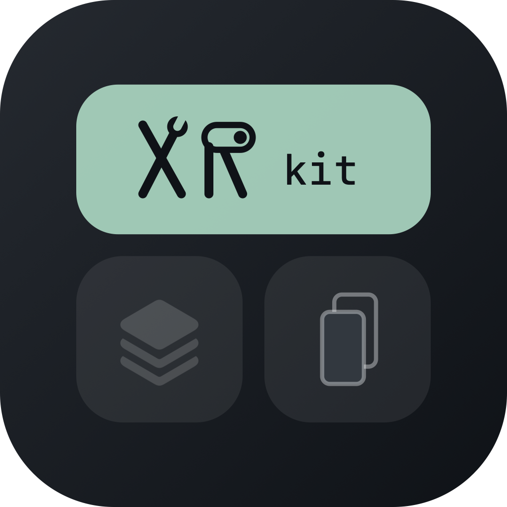

# xrkit



给 iOS 17 越狱设备用的综合优化插件：主屏幕、锁屏、控制中心、多任务，一个插件里按需开关。代码全部从头写。

> **适用系统**：iOS 17，**只在 iOS 17.3.1 上测试过**，其他版本可能有部分功能不生效。
> **越狱环境**：roothide（包架构 `iphoneos-arm64e`）。rootless / rootful 需要自己改打包配置。

## 安装

在 Sileo / Zebra 里添加软件源 `https://oryanfang.github.io/repo/`，搜索 **xrkit** 安装。也可以在 [Releases](https://github.com/oryanfang/xrkit/releases) 下载 `.deb`。

## 功能

**主屏幕**
- 隐藏：底部横条、负一屏、App 资源库、页面圆点、底部搜索按钮、图标名称、通知角标
- 文件夹：隐藏背景、文件夹图标显示第一个 App 的图标
- Dock：隐藏、背景样式（系统 / 深色 / 浅色 / 透明）、图标数量（3～6 个）
- 图标：角标跟随 App 主色调、下载时显示百分比、静止一段时间后半透明
- 截图：不显示左下角预览，直接存相册

**锁屏**
- 隐藏手电筒 / 相机按钮、「上滑打开」、右上角控制中心提示条
- 禁止左滑打开相机、禁止下滑搜索
- 面容识别后直接进主屏幕（可选：有通知时停在锁屏）
- 充电时显示电量、音乐播放器显示方式

**控制中心**
- 整体背景 / 模块背景透明度、模块圆角、隐藏状态栏
- 亮度和音量滑块显示百分比
- 模块加载器（可替代 CCSupport）：加载第三方模块，原本固定的模块也能移动、删除
- 自带模块：注销、锁屏、截屏、自动亮度、清除后台、xrkit 设置、VPN（长按切换）、深色模式、夜览、原彩、常亮、个人热点、定位、实时网速、电池信息

**多任务**
- 排列样式：系统 / 网格 / iPad
- 隐藏卡片名称和图标、长按锁定 App、下拉清除全部
- 卡片大小、圆角、间距、上下位置

**实验（Beta）**
- Mac 风格 Dock：运行中的 App 下面显示白点，竖线右边显示最近用过的 App

设置在「设置 › xrkit」。部分选项需要注销才生效，设置页里会标「需注销」。

## 编译

需要 [Theos](https://theos.dev)（roothide 版）和 GNU make 4（macOS 自带的 make 3.81 不行，用 Homebrew 的 `gmake`）。

```bash
gmake package                     # 调试版（会写调试日志）
gmake package FINALPACKAGE=1      # 正式版
```

直接装到手机：在项目根目录建一个 `local.mk`（不进仓库），写上手机地址：

```make
THEOS_DEVICE_IP = iphone.local
```

然后 `gmake package install`。Makefile 默认 Theos 在 `~/theos-roothide`，路径不同请改 Makefile 第一段。

## 目录

| 目录 | 内容 |
|---|---|
| `Tweak/` | 注入 SpringBoard 的代码，每个功能区一个文件 |
| `Shared/` | 偏好读取、通用工具、调试日志 |
| `Prefs/` | 设置面板；设置页内容由 `Prefs/make_plists.py` 生成 |
| `Modules/` | 自带的控制中心模块 |
| `Launcher/` | 调试版的桌面快捷入口 |
