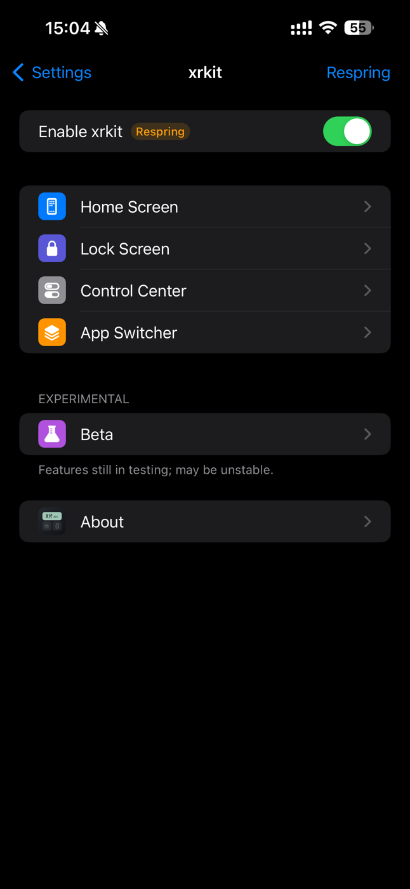
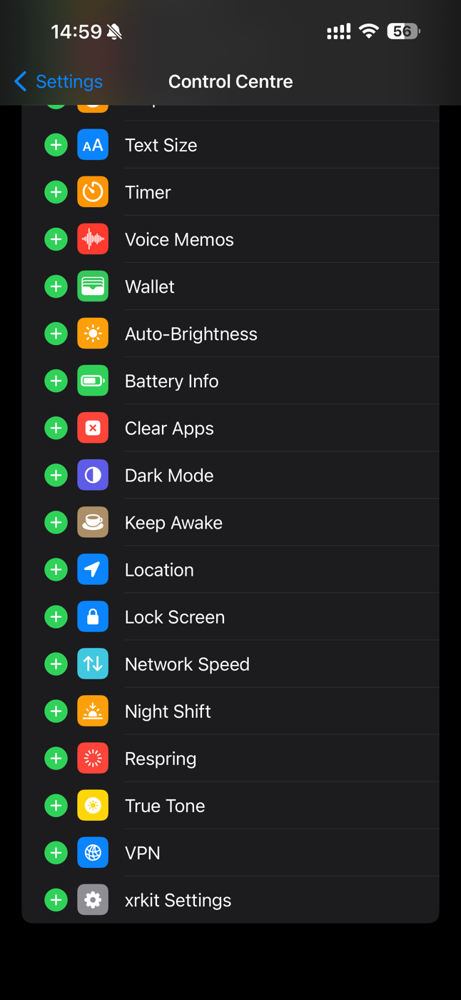
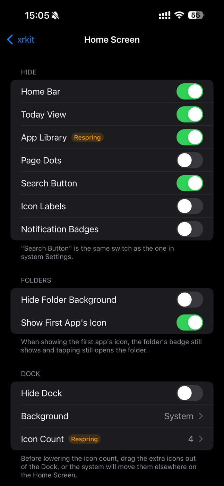

# xrkit

**iOS 17 越狱综合优化插件** · [English](README.md)

主屏幕、锁屏、控制中心、多任务，一个插件里按需开关。xrkit 把常用的系统小改动放在一个设置页里，还自带一个控制中心模块加载器和 15 个模块。代码全部从头写。

  
  
  

Objective‑C / Logos，Theos 编译，需要 **roothide** 越狱环境。适用 iOS 17，**只在 iOS 17.3.1 上测试过**，其他版本可能有部分功能不生效。设置界面有中文和英文：默认跟随系统语言，也可以在「关于 › 语言」里选（截图是英文界面）。

## 功能

**主屏幕**
- 隐藏：底部横条、负一屏、App 资源库、页面圆点、底部搜索按钮、图标名称、通知角标。
- 文件夹：隐藏背景、文件夹图标显示第一个 App 的图标（汇总角标照常显示）。
- Dock：隐藏、背景样式（系统 / 透明 / 深色 / 浅色）、图标数量（3～6 个，6 个时自动缩小图标）。
- 图标：角标跟随 App 主色调、下载时显示百分比、静止一段时间后半透明。
- 截图：不显示左下角预览，直接存相册。

**锁屏**
- 隐藏手电筒 / 相机按钮、「上滑打开」、右上角控制中心提示条。
- 禁止左滑打开相机、禁止下滑搜索。
- 面容识别后直接进主屏幕（可选：有通知时停在锁屏）。
- 充电时显示电量；音乐播放器可以暂停后收起或完全隐藏。

**控制中心**
- 整体背景 / 模块背景透明度、模块圆角、隐藏状态栏。
- 亮度和音量滑块显示百分比。
- 模块加载器（可替代 CCSupport）：加载第三方模块，原本固定的模块也能移动、删除。
- 自带模块：注销、锁屏、截屏、自动亮度、清除后台、xrkit 设置、VPN（长按切换）、深色模式、夜览、原彩、常亮、个人热点、定位、实时网速、电池信息。

**多任务**
- 排列样式：系统（堆叠）/ 网格 / iPad。
- 隐藏卡片名称和图标、长按锁定 App（锁住的划不掉）、任意卡片往下拉清除全部。
- 卡片大小、圆角、间距、上下位置。

**实验（Beta）**
- Mac 风格 Dock：运行中的 App 下面显示白点，竖线右边显示最近用过的 App。

**关于页**
- 语言（跟随系统 / 中文 / English）、查 GitHub 上有没有新版本、反馈问题、复制问题信息（版本、系统、机型和改过的设置，不含锁定了哪些 App）、重置所有设置。

设置在「设置 › xrkit」。部分选项需要注销才生效，设置页里会标「需注销」。

## 安装

在 Sileo / Zebra 里添加软件源 `https://oryanfang.github.io/repo/`，搜索 **xrkit** 安装。也可以在 [Releases](https://github.com/oryanfang/xrkit/releases) 下载 `.deb` 自己装。

只支持 roothide 越狱（包架构 `iphoneos-arm64e`）。rootless / rootful 需要自己改打包配置，见 [BUILDING.md](BUILDING.md)。

## 许可

本项目使用 [PolyForm Noncommercial License 1.0.0](LICENSE)：可以用于个人学习、研究和其他非商业用途，不可用于商业用途。
